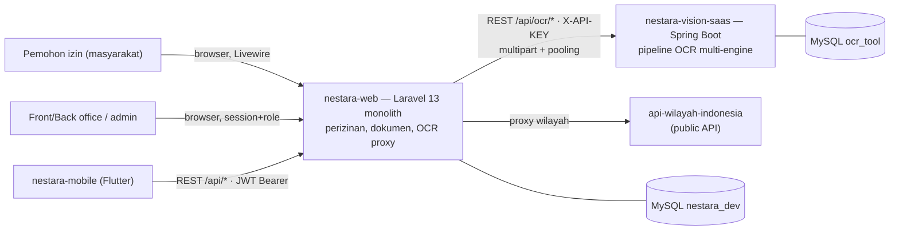
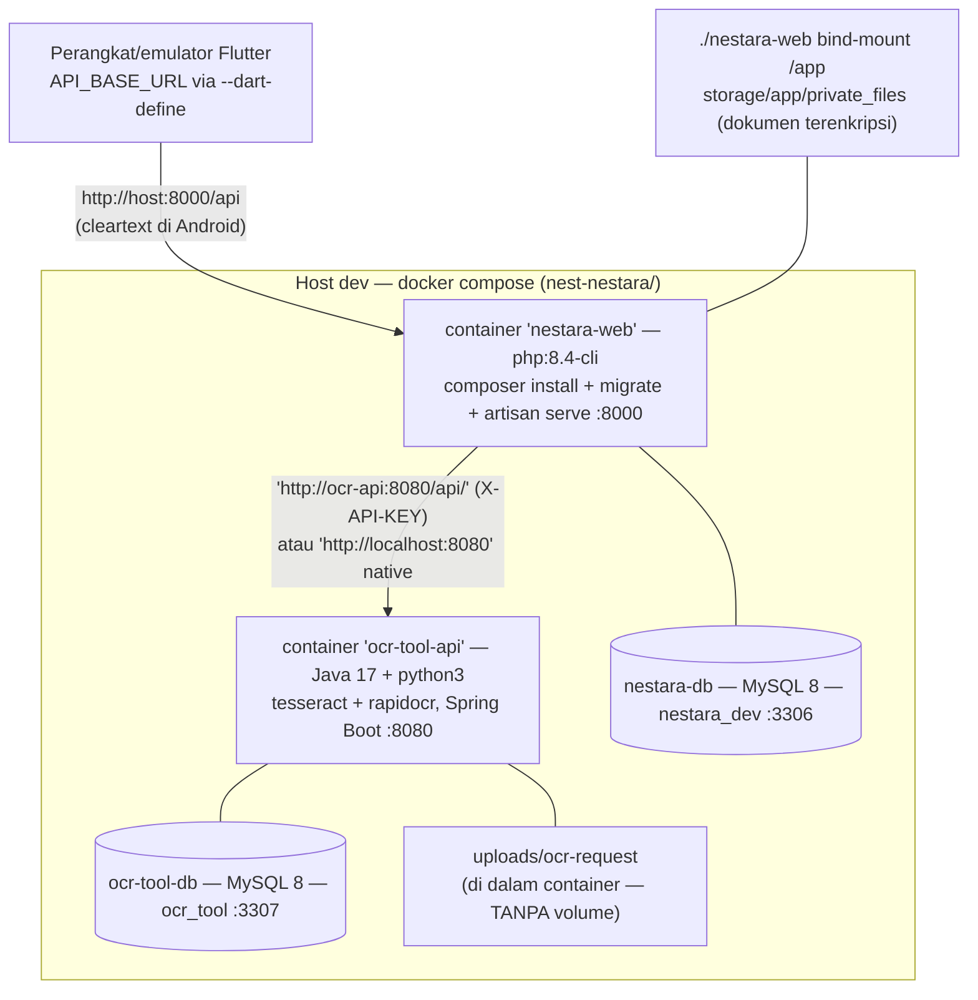

# 02 — Current System Architecture

Bagian dari *Current-State Architecture Review* Nestara (2026-10-19). Semua klaim di bawah berbasis kode aktual + konfigurasi Docker dev + file env; topologi produksi tidak tergetahui (dilabel UNKNOWN).

---

## 1. Ringkas: proses & konten

Empat deployment level dev (bukti utama: `nest-nestara/docker-compose.yml`):

1. **nestara-web** — Laravel 13 (PHP 8.4) monolith web+API (`artisan serve` single-thread di dev). Semua **domain perizinan** ada di sini: jenis izin, persyaratan, pemohon, alur proses front-office/back-office, status izin, dokumen terenkripsi, PDF & QR, OCR proxy ke Vision.
2. **nestara-vision-saas** — Spring Boot `ocr-tool` v0.7.0 (Java 17). **SaaS OCR multi-tenant** berarti penuh: registrasi + verifikasi email, API key `X-API-KEY`, kuota harian per tipe akun (Personal 20/Organization 50), audit log + dashboard statistik, playground OCR. Pipeline: pytesseract (primary) → tess4j+OpenCV (native) → RapidOCR → PaddleOCR (disabled).
3. **MySQL 8 ×2** — `nestara_dev` (web) dan `ocr_tool` (vision). Tidak ada shared DB; setiap app punya store sendiri.
4. **nestara-mobile** — Flutter; Android-first; iOS belum siap (`Info.plist` tanpa permission strings/ATS).

## 2. System context diagram



## 3. Container / deployment diagram (level dev)



### 3.1 Assumsi yang dikonfigurasi vs yang berbasis konsep

| Kebutuhan | Sumber konfigurasi (verified) | Status |
|---|---|---|
| Web→Vision base URL | **DB `pengaturan.OCR_BASE_URL` prioritas** (`OcrAPIServiceImpl2::getBaseUrl()`), fallback env `OCR_API_BASE_URL` | Enforced runtime |
| Vision API key | **DB `pengaturan.OCR_API_KEY`** → header `X-API-KEY` (`OcrAPIServiceImpl2::getApiKey()`) | Enforced runtime |
| Mobile→Web base URL | `--dart-define=API_BASE_URL` (`lib/flavor/config_dev.dart:10-13`); varian alpha/beta/stable di `anvil.yaml` | Compile-time; beta/stable **placeholder** `.example.com` |
| Kuota Vision | env `ACCOUNT_PERSONAL_DAILY_LIMIT=20` / `ACCOUNT_ORGANIZATION_DAILY_LIMIT=50` → seed `account_types.daily_limit` | Env, sekali-seed |
| Enkripsi dokumen web | `FileServiceImpl` (Laravel `Crypt`), abstraksi internal | Internal |
| Enkripsi API key Vision | AES-ECB dengan key dari `keystore.jks` yang ter-commit; password default `changeit` | **Risiko** (`VIS-F03`) |

**Risiko kesalahan yang dikonfigurasi vs konsep:** 3 lapis konfigurasi OCR pada web (env → `config/api-client.php` → DB `pengaturan`) berisiko silang saat `config:cache` di terkan, serta toggle `APP_OCR_SETTING` tidak tentu (see `WEB-F08`), dan 3 lapis konfigurasi vision placeholder menambal `(application.properties:55-58)` — doc drift di typical, see `VIS-F15`.

## 4. Internal architecture — per aplikasi

### 4.1 nestara-web — monolith Laravel berlayer

```
HTTP (routes/web.php + api.php)
  └─ Controllers  (Api\* — JWT; User/BackOffice/Layanan — session+role; Livewire ×48)
       ├─ DomainServices (interface + Impl: Pemohon, Perizinan, JenisPerizinan, SyaratIzin,
       │                   StatusIzin, EntriData, DokumenPemohon, Ocr, Pengaturan, User, Role…)
       ├─ AppService     (FileService — enkripsi-at-rest, EncryptionService, PdfTemplateService)
       ├─ APIClient      (OcrAPIService → Impl2 aktif; RegionAPIService → EmsifaAPIService)
       └─ Models (Eloquent, 22 migrations) + utils/enums (StatusIzinEnum — 9 status lifecycle)
Background: queue database; Job `SendOcrRequest` (proses izin web, jalur legacy `WEB-F05`)
File: storage/app/private_files/… (AES-encrypted), public/users (foto)
```

Fokus domain jelas terbaca dari desain `PerizinanServiceImpl` — kontroler tipis, logic di service. Detail alur: `05-end-to-end-workflows.md`.

### 4.2 nestara-vision-saas — Spring Boot berlayer + SaaS

```
interfaces/controller   OcrController (/api/ocr/*), AuthController, AccountVerificationController,
                        DashboardController (statistik/logs/api-key), TryOcrController (playground),
                        legal pages, ErrorController (@ControllerAdvice)
application/service     TextProcessorService (template abstract) → OcrProcessorService →
                        EnsembleOcrService {PyTesseract→tess4j→Rapid→Paddle(disabled)} +
                        ExtractedTextQueryService; LlmVisionExtractorService (stub, tidak aktif)
domain/model            User, Client, AccountType, ApiKey, ApiRequestLog, RequestUsage,
                        OcrRequest(WAITING|PROCESSING|DONE|FAILURE), OcrResult, ExtractedText,
                        VerificationCode; repository Spring Data
infrastructure/security ApiSecurityConfig (stateless /api/**, permitAll + ApiKeyAuthFilter);
                        WebSecurityConfig (dashboard formLogin session, csrf off);
                        ApiKeyService (AES-ECB keystore), AccountVerificationService
infrastructure/filemgr  LocalFileUploader (uploads/ocr-request), ExternalFileUploader (stub),
                        lib/PythonOcrExcecutor (ProcessBuilder, tanpa timeout — VIS-F09)
UI                      Thymeleaf: /auth, /account/verify, /dashboard, /ocr playground
```

Model "platform SaaS" (users/clients/keys/quota/logs) terpisah dari "domain OCR" (request/result/text) — structurally packed. Tetapi tidak ada tombol admin dan role ADMIN dead (see 03/SaaS inventory di `03-api-and-integration.md`).

### 4.3 nestara-mobile — Flutter, tanpa state framework

```
main.dart → splash → resolveSession → AuthGate (guest / incomplete / active)
client/    apiclient.dart (Retrofit — 3 endpoint auth) + 5 service Dio manual +
           token_manager (secure storage + migrasi legacy)   — TIDAK ada interceptor
model/     10 DTO manual fromJson/toJson (toleran null)
page/      15 layar — lengkapi_profil (gerbang OCR KTP), izinbaru (wizard 3-step),
           izin detail, profil, informasi kontak, pengaturan, auth
storage/   runtime_store (manifest index.json + salinan lampiran, offline view)
```

State: `StatefulWidget+setState` dominan + GetX (hanya navbar/tab-switch) + `UserState` (prefs, **mock**) — 4 pola berdampingan (`MOB-H01`, konsolidasi → D7 di `09-candidate-architecture-decisions.md`).

## 5. Matriks kepemilikan komponen

| Kamus | Owner (keputusan) | Konsumen | Perilaku |
|---|---|---|---|
| Domain perizinan + status lifecycle | web | mobile (read-only), vision tidak terlibat | Single authority; ok |
| Dokumen persyaratan (upload/encrypt/serve) | web | mobile (`/api/files` **tanpa auth**), vision legacy URL fetch | Tidak terlindungi (`WEB-F01`) |
| OCR KTP → data diri | **vision (pemrosesan)** + web (proxy, shaping & mapping) | mobile (upload + polling) | Fungsi utama cross-repo |
| OCR dokumen izin (pre-fill `entri_data`) | web memicu (queue job) → vision | back office (baca hasil) | Jalur legacy, bergantung queue worker + `/api/files` public + reachability (`XR-02`, UNRESOLVED) |
| User/acount | web (JWT+role) | mobile | — |
| API key vision | web (DB + admin UI) DAN vision (dashboard) | — | Duplikasi tanggung jawab, tanpa rotasi grace (VIS-F19, WEB-F08) |
| Wilayah Indonesia | web proxy Emsifa (+ cache file) | mobile via `/address/*` | — |

## 6. Deployment unknowns

| Pertanyaan | Status | Ritme |
|---|---|---|
| Topologi produksi (compose/VM/k8s)? | UNKNOWN — tidak ada artefak prod pada ketig-a repo | perlu konfirmasi stakeholder (09 D6) |
| Reachability `ocr-api` container → web container (untuk fetch URL `/files` legacy OCR) | TIDAK mis-terverifikasi di compose dev — tidak ada jaring khusus antara web & ocr-api selain DNS internal, `http://localhost:8000` (APP_URL) tidak akan bisa diakses ocr-api dari container | test runtime diperlukan (UNRESOLVED) |
| Queue worker web (`SendOcrRequest`) | tidak dijalankan di compose/testing; `artisan serve` tanpa worker | bagian jalur legacy gagal secara default (`WEB-F05`) |
| Scheduler web | `routes/console.php` hanya `inspire` — kosong | — |
| Mobile prod URL | beta/stable masih placeholder | 09 D7 |
| Simpan backup DB | tidak ada evidence | 09 D6 |
| iOS | belum di-set up (Info.plist permission/ATS) | 07, 09 |
