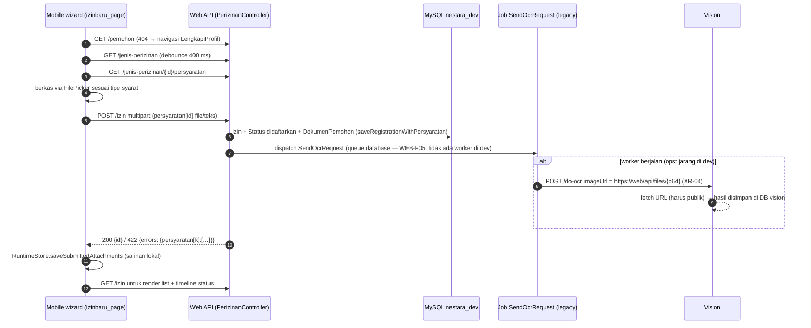
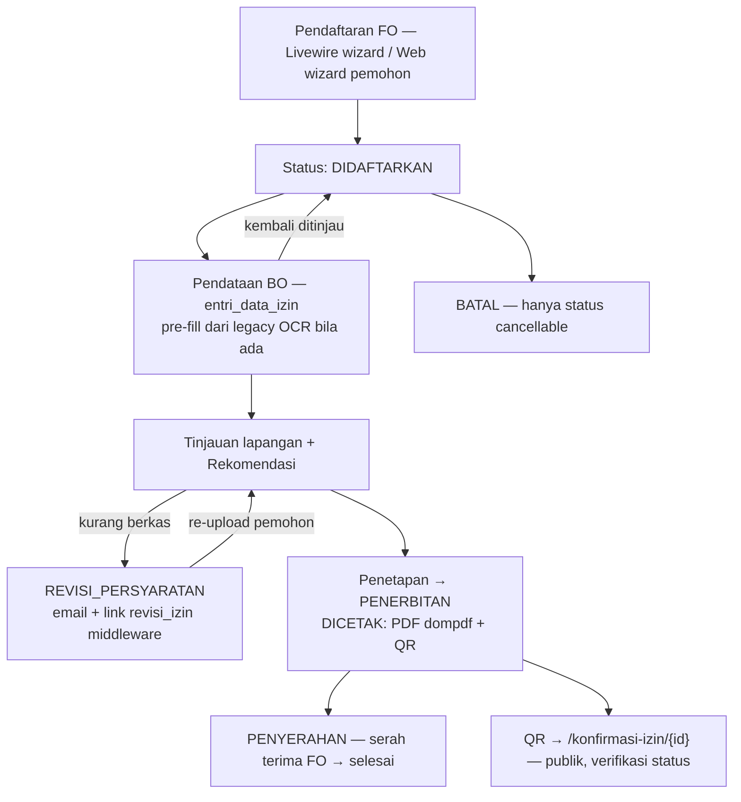

# 03 — API, Integration & Contract Analysis

Bagian dari *Current-State Architecture Review* Nestara (2026-10-19). Semua kontrak dipetakan dari **kode penyedia dan konsumen**, bukan dari dokumentasi.

Peta komunikasi aktual (semua HTTP/REST, terverifikasi lewat kode kedua sisi):

```
Mobile (Flutter)   ──JWT Bearer────►  Web /api/*            [satu-satunya jalur mobile]
Web (OcrAPIServiceImpl2) ──X-API-KEY─►  Vision /api/ocr/*     [multipart + polling]
Mobile             ──(tanpa auth)──►  Web /api/files/{b64}  [RuntimeStore, unduh lampiran]
Vision (legacy izin-OCR) ──HTTP GET──► Web /api/files/{b64}  [imageUrl pada do-ocr]
```

Tidak ada jalur Mobile→Vision langsung (grep = 0 referensi Vision/IP/port di lib mobile). Tidak ada callback Vision→Web pada kode utama (placeholder `perizinan-dpmptsp.api.base-url` di `application.properties:73` hanya dipakai test — lihat `10-evidence-and-open-questions.md`).

---

## 1. Inventori API Nestara-Web (penyedia; konsumen: mobile & desktop web)

Auth API: **JWT Bearer** (tymon/jwt-auth; TTL 30 hari, refresh 60 hari, `config/jwt.php`). Sumber utama: `routes/api.php`, controller `app/Http/Controllers/Api/*`, konsumen di `lib/client/service/*`.

| Endpoint | Method | Auth | Payload / params | Respons | Konsumen (mobile) |
|---|---|---|---|---|---|
| `/auth/register` | POST | publik | `username, password, konfirmasi_password` | user + verifikasi email | apiclient.dart:18-22 |
| `/auth/login` | POST | publik | `username, password` | `{access_token, token_type, expires_in, profile_complete}` | apiclient.dart:13-16 |
| `/auth/me` | GET | jwt.auth | — | user + `profile_complete` (butuh prefix `Bearer ` — sumber bug historis yang dikunci oleh regression test) | auth_service.dart:231-245 |
| `/auth/refresh` | POST | jwt.auth+jwt.refresh | — | `{access_token,…}` | auth_service.dart:250-268 |
| `/auth/logout` | POST | jwt.auth | — | — | auth_service.dart:275-291 |
| `/jenis-perizinan`, `/{id}`, `/{id}/persyaratan` | GET | jwt.auth | `search,page,limit(≤100)` | list/detail + `syarat_izin[]` | izin_service.dart |
| `/izin` | GET/POST | jwt.auth | POST multipart: `jenis_perizinan_id` + `persyaratan[{syarat_id}]` (file atau string) | list; `200 {id}`; `422 {errors:{persyaratan[k]:[…]}}` | izin_service.dart:89-132 |
| `/izin/{id}`, `/{id}/persyaratan` | GET | jwt.auth | — | detail; dokumen[] berisi `url_file` → `/api/files/{b64}` | izin_service.dart:65-82,179-192 |
| `/izin/{id}/cancel` | PATCH | jwt.auth | — | hanya status *didaftarkan/ditinjau/perbaikan-persyaratan* | izin_service.dart:212-225 |
| `/izin/{id}/delete` | DELETE | jwt.auth | — | soft-delete + hapus dokumen terkait | izin_service.dart:196-209 |
| `/address/regions/{type}/{parent_id}`, `/find-by-id/…`, `/find-by-name/{name}`, `/get-all` | GET | jwt.auth | type 1..4 | `{id,name}` (proxy Emsifa + cache) | address_service.dart |
| `/pemohon` | POST/GET | jwt.auth | payload `PemohonRequest` penuh (backend menolak partial — dicatat di mobile `edit_kontak_page.dart`) | `200 {id}` / `422 {errors}` | pemohon_service.dart |
| `POST /ocr/ktp` | POST | jwt.auth | multipart `image` (jpg/jpeg/png, **max 3 MB**) | `{status: done|pending|failed, data{nik,nama,alamat,…}, ocr_request_id}` | ocr_service.dart:83-89 |
| `GET /ocr/ktp/{request_id}` | GET | jwt.auth **+ ownership** (`user_id` × `request_id`) | — | status/hasil polling | ocr_service.dart:108-148 |
| `/user/update-profil`, `/user/update-password`, `DELETE /user/account` | PUT/PUT/DELETE | jwt.auth | `update-profil`: username wajik dikirim; `update-password`: **tidak diimplementasi di mobile** (fitur belum ada di UI) | — | auth_service.dart:340-404 |
| `/data-entri/{jenis_perizinan_id}` | GET | **publik** | — | definisi field dinamis izin | tidak dipakai oleh mobile (grep 0) |
| `/files/{file_name}` | GET | **PUBLIK (tanpa auth)** | `file_name = base64(nama_file)` | stream hasil dekripsi file privat | RuntimeStore mobile (tanpa header auth); juga dipakai legacy izin-OCR Vision (XR-04) |
| `/verify-client-token`, `/generate-client-token` | POST | publik / non-prod | HMAC client token | — | **tidak dipakai** oleh 3-app (`XR-05`) |
| `/up` | GET | publik | — | health OK | run_dev preflight |

Web desktop: 100+ route web (Livewire + dashboard, role-gated). Dead reference `App\Providers\EventServiceProvider` di `bootstrap/providers.php:4` (Low hazard).

**Catatan kontrak Mobile→Web:**
- Bentuk respons tidak dinormalisasi: list `jenis-perizinan` array langsung; `izin` list kadang nested paginasi — mobile menangani 3 bentuk via `_extractList` (`izin_service.dart:231-241`) — indikator bahwa **kontrak tidak pernah dieskripsi formal** (`XR-06`).
- Field `Izin.status[]` ditoleransi: mobile map `nama` ke warna status (`app_theme.dart:389-407`) — nilai status **enum backend web** dipakai langsung, tanpa mode normalisasi.

## 2. Inventori API Vision (penyedia; satu-satunya konsumen aktif: web)

Sumber: `interfaces/controller/OcrController.java`, config security, `application.properties`.

| Endpoint | Method | Auth | Payload | Respons (success) | Error |
|---|---|---|---|---|---|
| `POST /api/ocr/do-ocr` | POST | `ApiKeyAuthFilter` (X-API-KEY valid & belum expire → decrypt → clientId) + kuota harian per clientId | multipart/payload `image` (validator app: `@FileSize(3MB)`, `@FileType` png/jpeg) ATAU `imageUrl` (XOR); optional `requiredKeys[]` | `ApiResponse`: `{data:{requestId, status:\"PROCESSING\"}, success:true, errorMessage:null, statusCode:200}` | 400 (invalid payload), 503 (penuh executor), **500 leak via ErrorController** (`VIS-F04`) |
| `GET /api/ocr/check-status/{requestId}` | GET | idem | — | `{data:{requestId, clientId, status: WAITING\|PROCESSING\|DONE\|FAILURE, duration}, success:true}` | **NPE→500** saat ID tidak ditemukan (`OcrController.java:161-164` — `VIS-F04`); ownership mismatch → **404 without body** |
| `GET /api/ocr/get-result/{requestId}` | GET | idem | — | `{data:{requestId, status:\"DONE\", clientId, duration, extractedTexts:{k:v}}, success:true}` | idem |
| HTML `/auth/*`, `/account/verify`, `/dashboard/*`, `/ocr/extract` (playground) | — | session / verifikasi / formLogin | Thymeleaf | — | — |

Status model `ocr_request.status = WAITING|PROCESSING|DONE|FAILURE` (`domain/model/RequestStatus.java`). Kuota: `RequestLimitService.isRequestAllowed(clientId)` (20/50 by account type); `incrementUsage` hanya sesudah sukses; READ-modify-write **tanpa lock** (`VIS-F13`).

### 2.1 Pemetaan kontrak Web→Vision (dari kedua sisi, verified)

Pemanggil `OcrAPIServiceImpl2` (`app/Services/APIClient/Impl/OcrAPIServiceImpl2.php`): timeout request 25 s, connect 5 s, fetch 5 s; multipart field `image`; header `X-API-KEY`; cache hasil DONE 4 jam.

1. `POST /api/ocr/do-ocr` — web kirim `image` + `requiredKeys[]` (KtpFieldMapper.KTP_KEYS); vision validasi `image XOR imageUrl` → **match**, respons `data.requestId` di-parse web DTO `OcrResponse::fromJson` → **match**.
2. `GET /api/ocr/check-status/{id}` — web-map di `KtpFieldMapper.php:192-194`: `'DONE'→done`, `'WAITING','PROCESSING'→pending`, default (FAILURE dkk.) → `failed`. Vocabulary **match**; mobile tidak pernah melihat nilai mentah.
3. `GET /api/ocr/get-result/{id}` — `extractedTexts` berupa map; web filter/whitelist + normalisasi (KtpFieldMapper) sebelum dikirim ke mobile → decoupling yg bagus terhadap field engine-level (termasuk meta `_document_type`, `raw_text`).

### 2.2 Mismatch & risiko kontrak lintas-repo

| ID | Temuan | Bukti penyedia | Bukti konsumen | Dampak |
|---|---|---|---|---|
| **XR-01** | **Limit multipart tidak sinkron**: vision app-level 3 MB tetapi **Spring Boot default `spring.servlet.multipart.max-file-size`= 1 MB, tidak dikonfigurasi** | `application.properties` (tanpa key multipart), `OcrDataRequest` 3 MB, compose juga tidak set | web `OcrKtpRequest` max 3MB (`OcrKtpRequest.php:30`); mobile validasi ≤3MB (`lengkapi_profil_page.dart:39`) | Upload 1–3 MB ditolak Spring **sebelum** validator app → 500 `MaxUploadSizeExceeded` (tidak informatif). Foto KTP smartphone umum 2–5 MB; sampel dev semua ≤566 KB sehingga dev belum kena. **Severity High**, konfirmasi runtime direkomendasi. |
| **XR-02** | **Kecocokan timing: vision efektif sinkron** (bypass `@Async`, `VIS-F01`) dengan budget python 60 s — web do-ocr timeout 25 s | `TextProcessorService.java:41-56` (self-invocation), `Impl2.php:24` | Mobile receive-timeout 90 s | Saat do-ocr timeout: web tidak persist `ocr_ktp_requests` (record dibuat hanya saat response sukses, `Impl2.php:63-70`) → request_id vision orphan + kuota vision dinamakan; mobile menerima “layanan OCR tidak dapat dihubungi” padahal OCR masih jalan; hasil tidak pernah diambil (tidak ada korelasi balik). |
| **XR-03** | **Error-shape vision tidak konsisten**: 400 full shape; ownership-404 tanpa body; 500 leak `getLocalizedMessage` | `OcrController.java:53-58,131-134,161-175`; `ErrorController.java:43-52` | Web: 404→“unknown error” log + return null (Impl2:205-209) → mobile “failed” | Debugging 3 lapis sulit; info-leak; error mapping non-deterministik. |
| **XR-04** | **Legacy izin-OCR bergantung dua prasyarat publik**: (a) `/api/files/{b64}` publik (terkait `WEB-F01`), (b) reachability jaringan vision-container → web-container (fetch URL via `ImageIO`) | web `OcrServiceImpl::getUrlDokumen` (generates `route('api.render-file')`), `SendOcrRequest::dispatch` (`PerizinanServiceImpl.php:73`) | vision `PyTesseractOcrService.java:29` fetch URL bebas | Alur hanya berjalan bila queue worker hidup (default tidak: `WEB-F05`) **dan** jaringan o.k. Legacy flow efektif tidak beroperasi di dev; transparansi topologi UNRESOLVED. |
| **XR-05** | **Client-token endpoints tidak dikonsumsi siapa pun**: mobile tidak memanggil (grep 0), web admin Pegawai bisa membuat token; `ClientTokenService` memiliki bug (`!==` bukan `hash_equals`; counter `updateTokenUsed` tidak pernah bertambah) | `TokenController.php`, `ClientTokenService.php:139-174` | — | Permukaan legacy berduit + salah arah security review (timing compare). Kandidat penghapusan/revisi (09 D10). |
| **XR-07** | **Dedupe OcrRequest di Vision by `imageUrl` tanpa clientId** (`oucrRequestServiceImpl.java:34-44`) — dua client dengan imageUrl sama dapat berbagi/startTime satu row OcrRequest → ownership request_id kacau & kuota meleset (`VIS-F11`) | provider | web tidak aware | hasil milik request lama bisa terbaca oleh client lain (data cross-tenant kecil); ownership checker rusak. |

### 2.3 Matriks timeout/polling/retry (jalur OCR KTP aktif)

```
Mobile ──POST /ocr/ktp (upload ≤3MB)──► Web OcrController
  Web   : validasi + simpan file terenkripsi (private_files/ocr_ktp)
        ──POST vision /do-ocr (timeout 25s, connect 5s)──► Vision (sync, VIS-F01)
  Web   : DO-ocr ok → persist (ocr_ktp_requests user_id+request_id)
          internal loop sleep(2s) max 8s → check-status (5s) → mapStatus
        ──► Mobile {status: pending|done|failed, data?, ocr_request_id}
  Mobile: poll GET /ocr/ktp/{id} tiap 2 s, max 5 kegagalan beruntun, deadline 120 s
  Web   : state terminal → hapus file KTP disk (retensi), cache hasil DONE 4 jam
```

Catatan: web poll internal 8 s vs durasi OCR rata 27–60 s → mobile biasanya melakukan beberapa round trip. **Risiko utama** jatuh di XR-02 (do-ocr timeout → tidak ada request_id di web).

---

## 3. Diagram urutan (sequence)

### 3.1 Otentikasi & pembentukan sesi (Mobile)

```mermaid
sequenceDiagram
 autonumber
 participant U as Pengguna
 participant A as LoginPage / AuthService
 participant W as Web /api
 U->>A: username + password
 A->>W: POST /auth/login
 W-->>A: 200 {access_token, token_type, expires_in, profile_complete}
 A->>A: saveToken → flutter_secure_storage (token_manager.dart:15-24)
 alt profile_complete true
   A->>U: navigasi NavigationMenu
 else profile belum lengkap
   A->>U: navigasi LengkapiProfilPage (gerbang OCR)
 end
 Note over A,W: refresh hanya di launch-gate (resolveSession);<br/>401 mid-session tidak auto-refresh (MOB-H03)
```

### 3.2 OCR KTP end-to-end (Mobile → Web → Vision)

```mermaid
sequenceDiagram
 autonumber
 participant U as Pengguna
 participant M as Mobile (ScanProgressModal)
 participant W as Web OcrController
 participant IM as OcrAPIServiceImpl2
 participant V as Vision pipeline
 U->>M: pilih foto ≤3MB (image_picker)
 M->>W: POST /api/ocr/ktp (multipart, JWT)
 W->>W: validasi + simpan file terenkripsi private_files/ocr_ktp
 W->>IM: sendKtpImageRequest (timeout 25s)
 IM->>V: POST /api/ocr/do-ocr (multipart image + X-API-KEY)
 alt vision selesai < 25 s
   V-->>IM: {data:{requestId, status:PROCESSING/DONE}}
   IM-->>W: persist ktp_requests (user_id, request_id)
 else vision > 25 s (XR-02)
   W-->>M: 502 layanan tidak dapat dihubungi
   V-->>V: OCR tetap jalan; hasil tersimpan di DB vision (tanpa pemilik web)
 end
 loop web-internal ≤ 8 s (sleep 2 s)
   IM->>V: GET /api/ocr/check-status/{request_id} (timeout 5 s)
   V-->>IM: WAITING/PROCESSING/DONE/FAILURE
   W->>W: mapStatus → pending/done/failed (KtpFieldMapper.php:192-194)
 end
 W-->>M: {status, data?, ocr_request_id}
 alt done
   IM->>V: GET /api/ocr/get-result/{id} (cache 4 jam di web)
   V-->>IM: {extractedTexts:{nik,nama,alamat,…}}
   W->>W: whitelist+normalisasi KtpFieldMapper → data
   W->>W: hapus file KTP disk (retensi terminal)
   M->>U: prefill + resolve wilayah fuzzy + POST /pemohon
 else pending
   loop Mobile GET /ocr/ktp/{request_id} tiap 2 s (deadline 120 s, ≤5 gagal)
     M->>W: status polling
     W->>V: check-status (ownership dicek di sisi web)
   end
 else failed
   W-->>M: {status:failed} → pesan informatif; file disk dihapus
 end
```

### 3.3 Pengajuan izin (Mobile → Web)



### 3.4 Lifecycle proses izin (Web back-office + QR)



## 4. Auth dan trust boundary antar aplikasi

| Sistem | Mekanisme | Catatan |
|---|---|---|
| Mobile → Web | JWT Bearer (TTL 30 hari / refresh 60) — token di secure storage | tidak ada machine key; penanganan 401 mid-session lemah (`MOB-H03`) |
| Web → Vision | API key statik (AES terenkripsi di DB web) → `X-API-KEY` header | Key hidup di dua sisi; Vision mengenal **client**, bukan user web; praktis 1 tenant aktif (web) |
| Web internal | session database + Spatie roles (pemohon/front-office/back-office/admin) | permission Spatie tidak pernah dipakai (hanya role) |
| Vision internal | sesi + verifikasi email + API key; role `CLIENT` (role `ADMIN` dead code) | — |

**Tidak ada SSO; user web tidak dikenal Vision.** Pemohon = baris `users` di DB web; akun vision = client integrator (praktis: 1 client aktif untuk web + 1 client playground). 

## 5. Kesimpulan integrasi

- Ketiga jalur aktif (mobile↔web↔vision) berjalan dan konsisten pada level field di dev — kontrak fungsional cukup lestari karena field names/status dipelihara manual.
- **Risiko integrasi terbesar berada di failure mode**, bukan happy path: XR-01 (multipart limit), XR-02 (timing sync 25 s vs 60 s), XR-03 (error shape), XR-04 (legacy flow bergantung prasyarat yang tidak terverifikasi), WEB-F01 (endpoint publik yang sengaja dipakai untuk integrasi).
- Tidak ada artefak kontrak bersama (OpenAPI dsb.): field names/status literal diduplikasi di 3 repositori (ktp_ocr_result.dart ← `KtpFieldMapper` ← extractedTexts Vision) — setiap perubahan bersifat break-banyak (`XR-06`).
