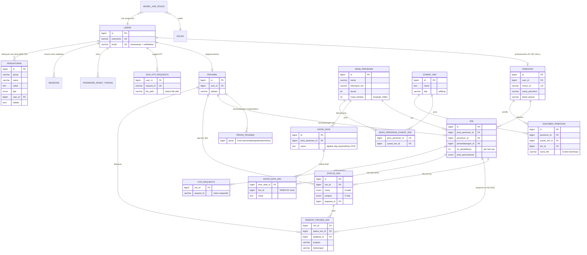

# 04 — Data Model & ERD

Bagian dari *Current-State Architecture Review* Nestara (2026-10-19). Konstruk kedua database direkonstruksi dari migrations/entitas aktual — bukan dari dokumentasi.

---

## 1. Inventaris database

| Properti | DB web — `nestara_dev` | DB vision — `ocr_tool` |
|---|---|---|
| Engine | MySQL 8 (utf8mb4, strict — `config/database.php:52-57`) | MySQL 8 |
| Skema | Laravel migrations (22 file, `database/migrations`) | **Hibernate `ddl-auto=update` — tanpa migration tool** (`application.properties:17`) |
| Owner aplikasi | nestara-web | nestara-vision-saas |
| Akses pihak lain | mobile tidak pernah akses DB langsung; vision tidak | web tidak |
| Backup | tidak ada evidence | tidak ada evidence |
| Bukti drift | index migration ditambahkan 2026-08-21 (indikasi tuning aktif); FK-change `pemohon.user_id SET NULL` 2026-08-25 | UUID AUTO vs kolom MySQL, tanggal `RequestUsage.request_date` DATE dari `Instant` (server-tz dependent) |

## 2. ERD — DB web (nestara_dev)



Catatan integritas (verified):
- `entri_data_izin.izin_id` **tanpa FK** (migration 2024_07_05) — satu-satunya tabel domain tanpa constraint FK.
- `status_izin` dipetakan sebagai append-log per nama status (upsert-by-(izin_id,nama) di `StatusIzinService`) — timeline dipertahankan.
- Composite index ditambahkan 2026-08-21: `status_izin(izin_id,nama,created_at)`, `(nama,progres)`, `izin(created_at)`, `izin(no_pendaftaran)`, `pemohon(nama_pemohon)` — tuning query aktif.
- `Pengaturan` berperan sebagai *registry konfigurasi runtime* (OCR_API_KEY/OCR_BASE_URL, client-token, format surat, counter) — data tabel yang aktif sangat kritis namun auditnya belum ada (`WEB-F14`). Bug `find(user_id)` di `PengaturanServiceImpl:24-30` membaca `id` bukan `user_id` (`WEB-F03`).
- Race `no_pendaftaran` per-hari tanpa lock (`WEB-F16`).

## 3. ERD — DB vision (ocr_tool)

```mermaid
erDiagram
    users ||--o| clients : "1:1 client.user_id cascade ALL"
    clients }o--|| account_types : "daily_limit 20/50"
    clients ||--o| api_keys : "client_id unique - TIDAK ada FK"
    clients ||--o{ request_usages : "client_id - TIDAK ada FK"
    clients ||--o{ api_request_logs : "client_id - TIDAK ada FK"
    users |o--o{ verification_codes : "user_id FK"
    ocr_request |o--o| ocr_result : "ocr_result.ocr_request_id unique"
    ocr_result |o--o{ extracted_text : "field k:v"

    users { varchar id PK username UK password_bcrypt role "CLIENT/ADMIN" status "ACTIVE/PENDING/LOCKED/DISABLED/EXPIRED" }
    clients { bigint id PK varchar user_id FK varchar client_id UK "uuid string" email UK account_type_id FK }
    account_types { name daily_limit description }
    api_keys { bigint id PK varchar client_id UK api_key "AES-ECB app_b64" expires_at "180d" }
    api_request_logs { endpoint http_method ip response_status request_time client_id }
    request_usages { client_id request_count request_date "DATE, definition UTC" }
    verification_codes { bigint user_id FK code "6 digit" expires_at "1j" }
    ocr_request { varchar id PK id image_url status "WAITING/PROCESSING/DONE/FAILURE" client_id }
    ocr_result { varchar id PK varchar ocr_request_id FK UK is_success error_message duration "ms" original_extracted_text "TEKS FULL PII" }
    extracted_text { text_key text_value "field hasil (NIK dsb.)" }
```

Catatan vision (verified):
- `api_keys`, `api_request_logs`, `request_usages`, `ocr_request` **TIDAK** ber-FK ke `clients` (hanya string client_id) — integritas logikal tidak enforce DB (`VIS-S-data`).
- `ddl-auto=update` + tanpa Flyway/Liquibase = schema drift risk, terfulla di `application.properties:15-17` dan compose.
- **Retensi**: `ocr_result.original_extracted_text` menyimpan NIK ring + nama tetap permanen; `uploads/ocr-request` berisi file KTP tanpa retention/policy dan tanpa volume mount (`VIS-F07`). Ini adadados PII yang harus terselesaikan cepat (06 §S.7 & 09 D5).
- `verification_codes` — beberapa code valid diperbolehkan bersamaan; lookup tidak di-scope user (`VIS-F05`).

## 4. Mapping entitas lintas-sistem & data churn

Concept yang **sama** di 2 database; authoritativeness:

| Konsep | Di DB web | Di DB vision | Authority | ID generation | Orphan risk |
|---|---|---|---|---|---|
| OCR request id | `ocr_requests.request_id` / `ocr_ktp_requests.request_id` | `ocr_request.id` (UUID) | web menyimpan link; vision menyimpan lifecycle | UUID vision | web row tanpa vision row (XR-02), atau vision row orphan (XR-02) |
| hasil OCR (fields k:v) | hasil text/entri_data_izin (hasil after mapping) | `extracted_text` k:v + `ocr_result.original_extracted_text` | vision raw; web closure untuk domain use | — | web cache 4 jam vs vision rate-limited sync; tidak ada protocol remove |
| user / pemohon | `users`, `pemohon` | tidak ada | web | auto-increment | vision tidak simpan |
| API key | `pengaturan` (angka row, tanpa ID versi) | `api_keys` | vision meng-create; web menyimpan copy | — | tidak ada protocol revoke/rotasi berpadat (09 D8) |
| dokumen berkas | `dokumen_pemohon.nama_file` + file disk terenkripsi web | file disk vision `uploads/*/filename` | web | random name | vision upload permanen, web bisa dihapus — **sinkrok tidak** |

**Sinkronisasi adalah SATU-ARAH dan hanya berupa push (web→vision)**; tidak ada protocol pull-back, tidak ada TTL/housekeeping di kedua DB. Deletion di web tidak terpropagasi ke vision: hasil NIK tetap tersimpan di vision (risiko PDP).

## 5. Resiko konsistensi cross-DB (dikonfirmasi vs potensi)

| ID | Jenis | Temuan | Status |
|---|---|---|---|
| **CR-01** | Dikonfirmasi | Web menyimpan `ocr_ktp_requests` hanya saat do-ocr sukses (≤25 s). Bila do-ocr timeout (XR-02), terjadi **orphan di vision** (OCR jalan / hasil tersimpan) tanpa pencatatan di web → kuota vision terpakai tanpa hasil yang bisa diambil. | confirmed |
| **CR-02** | Dikonfirmasi | Retensi PII tidak seimbang: hapus akun web menghapus file KTP dari disk web; **vision tetap menyimpan `original_extracted_text` (+ file di uploads)** tanpa retention policy | confirmed |
| CR-03 | Potensial | Bila do-ocr web gagal mid-flight (timeout), mobile tidak pernah menerima `ocr_request_id` sehingga hasil OCR di vision tidak bisa diambil tapi tetap menghabiskan kuota | confirmed flow |
| CR-04 | Potensial | Cache hasil DONE di web 4 jam — status tidak bisa "turun" dari DONE (vision tidak menghapus result), sehingga staleness tinggal sedikit; tetapi bila row intent/nah dihapus vision, cache web bisa memegang data orphan selama 4 jam | low-risk |
| CR-05 | Potensial | Kuota vision dihitung hari UTC vs chart harian pakai `ZoneId.systemDefault()` (`VIS-F14`) — definisi "hari" tidak konsisten lintas modul | confirmed internal |
| CR-06 | Dikonfirmasi | `api_keys`, `request_usages`, `api_request_logs`, `ocr_request` tidak ber-FK ke `clients` di DB vision — integritas hanya logikal, tidak di-enforce DB | confirmed |

## 6. Referensi & bukti

- Web: `database/migrations/*`, `app/Models/*`, `StatusIzinService`, `PengaturanServiceImpl`.
- Vision: `domain/model/*.java`, `application.properties`, `RequestLimitService`.
- Bukti temuan detail: `10-evidence-and-open-questions.md` dan `03-api-and-integration.md`.
