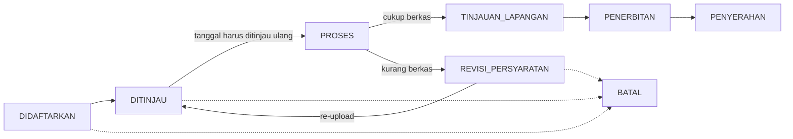

# 05 — End-to-End Domain Workflows

Bagian dari *Current-State Architecture Review* Nestara (2026-10-19). Setiap alur direkonstruksi dari kode aktual (controller/service/model) — bukan asumsi dari nama direktori.

---

## 1. Inventori workflow

| # | Workflow | Trigger / aktor | Komponen bukti (path & symbol) | Bentang |
|---|---|---|---|---|
| W1 | Registrasi + login | Pemohon (web & mobile) | `app/Http/Controllers/Api/AuthController.php`; web `laravel/ui` routes; mobile `auth_service.dart` | web + mobile |
| W2 | Lengkapi profil via OCR KTP | Pemohon (mobile) | `page/lengkapi_profil_page.dart` → `ocr_service.dart` → `Api/OcrController.php` → `OcrAPIServiceImpl2` → Vision `OcrController` | mobile→web→vision |
| W3 | Pengajuan izin (mobile, wizard 3-step) | Pemohon | `page/izinbaru_page.dart` → `izin_service.dart` → `Api/PerizinanController.php` `create` | mobile→web |
| W4 | Pengajuan izin (web pemohon) | Pemohon | `app/Livewire/User/CreateIzin.php` → `PerizinanServiceImpl::saveRegistrationWithPersyaratan` | web |
| W5 | Pemrosesan back-office | FO/BO pegawai | `app/Livewire/Dashboard/BackOffice/{Pendataan,Rekomendasi,Penetapan}` + `EntriDataTrait`, `TinjauanLapanganTrait`, `RekomForm` | web |
| W6 | Revisi berkas | Pemohon via email | `RegistrationRevisionMail` link `/revisi-izin/{id}` + middleware `revisi_izin`; `app/Livewire/User/RevisiIzin` | web |
| W7 | Penyerahan izin | FO pegawai | `app/Livewire/Dashboard/Penyerahan/PenyerahanIndex` | web |
| W8 | Verifikasi QR izin | Publik | `/konfirmasi-izin/{izin_id}` (decrypt id, no auth) | web |
| W9 | OCR dokumen izin (pre-fill `entri_data`) | Job queue web | `app/Jobs/SendOcrRequest.php` → `DomainServices/Impl/OcrServiceImpl.php` → Vision `imageUrl` | web→vision (kondisional) |
| W10 | Cancel / delete izin | Pemohon | `PATCH /izin/{id}/cancel`, `DELETE /izin/{id}/delete` — `PerizinanServiceImpl.php:325-331` | web+mobile |
| W11 | Hapus akun | Pemohon | `Api/UserController::deleteAccount` (cone-mail remove, hapus file KTP disk, token cleanup) | web+mobile |
| W12 | Vision SaaS dashboard (stats/logs/api-key/playground) | Client SaaS | `DashboardController`, `TryOcrController`, `AccountVerificationService` | vision internal |
| W13 | Manajemen pengaturan web (Kop Surat, OCR config, token pegawai) | Admin | `app/Livewire/Admin/Pengaturan.php` + `PengaturanToken` | web |

## 2. Journey utama — dari OCR KTP sampai izin terbit

```mermaid
flowchart TD
    A["Registrasi user + role 'pemohon'"] --> B[LengkapiProfilPage — gerbang OCR KTP (tanpa skip)]
    B -->|"W2 — OCR KTP\n(sequence diagram 03 §3.2)"| C[Pemohon tersimpan → gate sessi active]
    C --> D["W3/W4 — pengajuan izin\nwizard mobile / wizard web"]
    D --> E["POST /izin → Izin + DokumenPemohon (file terenkripsi)\nStatus: DIDAFTARKAN"]
    E -.->|W9 job legacy, kondisional| Q["SendOcrRequest queue → vision\npre-fill entri_data"]
    E --> F[W5 — pendataan BO]
    F --> G{"berkas lengkap?"}
    G -->|tidak| H["REVISI_PERSYARATAN\nemail link revisi berkala"]
    H -->|re-upload| F
    G -->|ya| I["tinjauan lapangan → rekomendasi\ncatatan: direkom / tidak / catatan"]
    I --> J["penetapan → PENERBITAN\ncetak PDF dompdf + QR"]
    J --> K[W7 — penyerahan → PENYERAHAN (terminal)]
    K --> L[W8 — QR verification publik]
    A --> M[BATAL — hanya saat DIDAFTARKAN s/d REVISI_PERSYARATAN]
```

## 3. Detail W5 — lifecycle status izin (web)

State machine eksplisit di `StatusIzinEnum` + `StatusIzinService` (bukti `updateStatusIzin` upsert berdasarkan `(izin_id, nama)`):



Cancellable hanya `DIDAFTARKAN`, `DITINJAU`, `REVISI_PERSYARATAN` (`PerizinanServiceImpl.php:325-331`). Delete permanent = soft-delete + exclude rows (audit tetap ada).

| Langkah | Aktor | Komponen | Status |
|---|---|---|---|
| Pendaftaran | FO | `Dashboard\Pendaftaran\*` + `DataIzinCreate` | `DIDAFTARKAN` |
| Pendataan (entri_data) | BO | `BackOffice\Pendataan` + `EntriDataTrait` | `DITINJAU` → `PROSES` |
| Tinjauan lapangan + rekomendasi | BO | `BackOffice\Rekomendasi` + `TinjauanLapanganTrait` + `RekomForm` | catatan `REVISI_PERSYARATAN` / lanjut |
| Penetapan + cetak | BO | `BackOffice\Penetapan` + `updateCetakIzinStatus`; surat → `dompdf` template; QR endroid | `PENERBITAN` |
| Penyerahan | FO | `PenyerahanIndex` | `PENYERAHAN` |

## 4. Lifecycles: dokumen / OCR / izin — pasang-pasangannya

**Tiga lifecycle diidentifikasi:**

| Lifecycle | Model | Owner | Persist |
|---|---|---|---|
| Izin (bisnis) | eksplisit, 9 status enum + tabel log `status_izin` + `riwayat_proses_izin` | web (`StatusIzinService`) | `nestara_dev` |
| Dokumen persyaratan | implisit: `DokumenPemohon` rows + disk encrypted path | web (`FileService`) | disk `private_files` + DB |
| OCR | dua level: web-level `pending|done|failed` (sintesis) + vision-level `WAITING|PROCESSING|DONE|FAILURE` (entity) | web proxy + vision | kedua DB |

**Perpasing antar lifecycles:**

- `Izin ↔ OCR`: **kondisi**. Jalur izin-dokumen OCR (W9) menyimpan `ocr_requests.izin_id`; jalur KTP OCR (mobile) menyimpan `ocr_ktp_requests.user_id` (bukan izin_id — memang tidak ada hubungan langsung).
- `Dokumen ↔ OCR`: **kondisi, hanya jalur W9** — URL publik file (`/files/{b64}`) dikirim sebagai `imageUrl` ke vision.
- `OCR → Izin`: hasil pre-fill `entri_data_izin` (manual oleh petugas di jalur W9; mobile KTP-prefill hanya memanfaatkan data `pemohon`, buat izin tidak automatis).

Perhatian: **hasil OCR tidak pernah otomatis menulis final** — semua pemanggilan tetap dalam tahap manual/verifikasi petugas (pilihan produk, bukan bug).

## 5. Failure handling per workflow

| Skenario | Perilaku implementasi sekarang | Bukti | Kategori |
|---|---|---|---|
| do-ocr web timeout 25 s | web → 502 "layanan OCR tidak dapat dihubungi" ke mobile; vision tetap memproses; web tidak mencatat request | `OcrAPIServiceImpl2:24,63-70`; `XR-02` | Integrasi |
| OCR FAILED | web map `failed`; mobile tampil message; file KTP disk web dihapus; polling utk per-status tetap aman | `OcrController.php:86-93,141` | OK |
| Vision down | web Impl2 log error, null response; mobile dapat 502; user dapat retry | `Impl2` + `OcrController.php:50-53` | OK degrade |
| requestId Vision tidak eksis | vision NPE → 500 + leak message; web log; mobile generic | `VIS-F04` | Info-leak |
| queue worker tidak hidup | W9 jobs tertahan di queue table; tidak ada retry/alert | compose; `WEB-F05` | Ops gap |
| Kuota vision habis | 400 "Request limit exceeded" per hari | `RequestLimitService` | OK |
| multipart >1MB (XR-01) | Spring 500 MaxUploadSizeExceeded sebelum validator 3MB; mobile melihat generic error | vision default | Integrasi (High) |
| 401 mid-session (mobile) | generic; tidak auto-refresh | `MOB-H03` | UX |
| Livewire tmp web | dihapus seluruh dir oleh concurrent upload lain (Web 502 behavior) | `FileServiceImpl:71-75`, `WEB-F09` | Concurrency bug |

## 6. Gap workflow

- **update-password**: endpoint web siap, mobile tidak punya UI (grep 0) → pengguna hanya bisa via web.
- **audit trail formal**: tidak ada audit log terstruktur di web & vision (hanya log app / api_request_logs vision).
- **retensi & housekeeping**: tidak ada scheduled task (`routes/console.php` kosong); uploads vision + `verification_codes` tidak pernah dibersihkan; `livewire-tmp` web terhapus per-batch (bug `WEB-F09`).

## 7. Tidak dapat diverifikasi dari kode

| Hal | Status |
|---|---|
| Perilaku runtime W9 (OCR legacy izin) | tidak terverifikasi — bergantung queue worker + reachability jaringan (UNRESOLVED, 09 D6) |
| Perilaku update-status izin di bawah konkurensi (race `no_pendaftaran`) | potensi race (`WEB-F16`), belum terlihat di dev |
